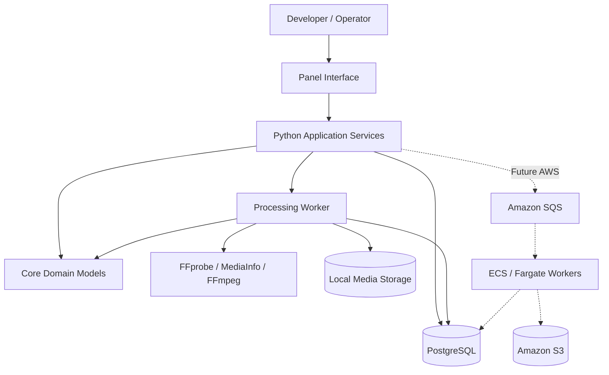

# FrinkWorks - System Architecture

**Status:** Initial design
**Milestone:** M0 - Project Foundation

## 1. Purpose

FrinkWorks is a Python-based media asset management (MAM), automated quality control (QC), and media processing platform.

The system is designed to support professional media workflows, including:

- Media asset registration and tracking
- Technical metadata extraction and normalization
- Configurable automated quality control
- Video and audio signal analysis
- Dolby Vision and IMF metadata validation
- Interactive asset browsing and QC reporting
- Local and cloud-based processing
- Operational analytics and reporting

The initial implementation will run locally. Its architecture will support future deployment to AWS without requiring major changes to the core domain models or QC engine.

### 1.1 Project Scope

FrinkWorks is a personal software engineering and media technology portfolio project.

It is not intended to operate as a commercial media asset management service or to receive deliverables from external clients.

All media assets will be supplied, generated, or selected by the project developer for testing, analysis, and demonstration purposes.

The system will simulated relevant professional media workflows, including ingest, technical metadata analysis, automated QC, asset management, and reporting.

The architecture will emphasize realistic engineering practices while avoiding unnecessary client management, multi-tenant access, billing, and production infrastructure.

## 2. Architectural Principles

### 2.1 Modular Design

FrinkWorks separates responsibilities into independent Python modules.

Each module should have a clearly defined purpose and avoid unnecessary dependencies on unrelated componentes.

### 2.2 Separation of Concerns

The user interface, application services, domain models, and media processing components should remain logically separate.

For example, the Panel interface should not directly execute long-running FFmpeg processing jobs.

### 2.3 Portable Processing

Media analysis and QC rules should operate independently of their execution environment.

The same core processing logic should eventually support:

- Local development and execution
- Background workers running in Docker containers
- AWS-based processing workers

### 2.4 Structured Results

Metadata extraction and QC processing should produce consistent, machine-readable results.

These results will support:

- Automated validation
- Database persistence
- JSON exports
- Interactive dashboards
- Historical analytics

### 2.5  Incremental Development

Components will be introduced as required by the development roadmap.

The initial architecture should avoid unnecessary infrastructure complexity while preserving the ability to extend the system.

## 3. Major System Components

| Component | Responsibility |
|---|---|
| Domain | Defines assets, asset versions, QC profiles, jobs, and findings |
| Ingest | Registers assets and coordinates ingest workflows |
| Metadata | Extracts and normalized technical media metadata |
| QC Engine | Evaluates media against configurable QC rules |
| Storage | Manages database persistence and media storage |
| Workers | Executes background metadata and QC processing |
| API | Exposes application operations and results |
| UI | Provies asset management, QC monitoring, and analytics |

### 3.1 Domain Layer

The domain layer defines the core entities and business rules used throughout FrinkWorks.

Initial planned entities include:

- `Asset`
- `AssetVersion`
- `QCProfile`
- `QCJob`
- `QCFinding`

Domain models should not depend on Panel, AWS, or a specific database implementation.

### 3.2 Ingest Layer

The ingest layer coordinates the registration of media assets.

Planned responsibilities include:

- Accepting references to local or cloud-hosted media
- Registering assets and their versions
- Identifying file types and storage locations
- Initiating metadata extraction
- Supporting file integrity checks

### 3.3 Metadata Layer

The metadata layer extracts and normalizes technical information from media files.

Planned tools include:

- FFprobe
- MediaInfo

Extracted information may include:

- Container format
- Video and audio codecs
- Resolution and frame rate
- Duration
- Bit depth and color characteristics
- Audio channel configuration
- Timecode information

### 3.4 QC Engine

The QC engine evaluates media against configurable rules and profiles.

Initial responsibilities include:

- Loading QC profiles
- Executing metadata validation rules
- Producing structured findings
- Assigning pass, warning, or failure outcomes
- Recording checks that could not be evaluated

More advanced signal analysis and Dolby Vision/IMF validation will be introduced in later milestones.

### 3.5 Storage Layer

The storage layer manages persistent application data and references to media assets.

Planned storage technologies include:

- PostgreSQL for structured application data
- Local filesystem storage for development
- Amazon S3 for future cloud media storage.

Database access should be separated from domain business logic.

### 3.6 Processing Workers

Workers execute tasks that may be computationally expensive or time-consuming.

Examples include:

- Technical metadata extraction
- File checksum calculation
- Automated QC analysis
- Video and audio signal analysis

Workers should produce structured results that can be persisted and displayed by other components.

### 3.7 API Layers

The API layer will provide a consistent interface for application operations.

FastAPI is the planned framework.

Potential operations include:

- Registering assets
- Retrieving asset metadata
- Submitting QC jobs
- Checking job status
- Retrieving QC findings

The API will be introduced when the application requires it rather than as an initial dependency.

### 3.8 User Interface

The user interface will be built primarily with Panel, Holoviews, and hvPlot.

Planned functionality includes:

- Media asset browsing
- Technical metadata inspection
- QC profile selection
- QC job monitoring
- Findings review
- Interactive analytics dashboards

The interface should communicate with application services rather than implement QC business logic directly.

## 4. Media Ingest and QC Processing Workflow

### 4.1 Workflow Overview

FrinkWorks processes media assets through a series of coordinated operations.

The initial workflow consists of:

1. Asset registration
2. File identification
3. Technical metadata extraction
4. Metadata normalization and persistence
5. QC job creation and profile selection
6. QC rule evaluation
7. QC result persistence
8. Results presentation and reporting

The workflow should support asynchronous processing so that long running operations do not block the user interface.

### 4.2 Asset Registration

The developer selects a local media file or an existing S3 object for registration in FrinkWorks.

An application service creates or identifies an `Asset` and associates it with an `AssetVersion`.

An `Asset` represents a logical media item, while an `AssetVersion` represents a specific media file or revision.

The system records the file's storage reference and relevant identifying information.

Initial development will support manually selected local files. S3-based registration will be introduced during AWS integration.

### 4.3 File Identification and Integrity

The ingest process verifies that the referenced file is accessible.

File properties may include:

- Filename and extension
- File size
- Storage location
- File checksum
- Registration timestamp

A checksum such as SHA-256 can be used to detect changes to a file and verify integrity.

A checksum alone does not establish whether two media assets represent the same creative content.

### 4.4 Technical Metadata Extraction

A processing worker invokes FFprobe and/or MediaInfo to inspect the media.

The tools return technical metadata, which is parsed into a normalized internal representation.

The original tool output may also be retained for troubleshooting and future reprocessing.

Extraction failures should be recorded rather than silently discarded.

### 4.5 Metadata Persistence

Normalized metadata is associated with the appropriate `AssetVersion`.

PostgreSQL will eventually store asset records, version information, technical metadata, and processing status.

Large media files remain in their original storage locations rather than being stored directly inside PostgreSQL.

### 4.6 QC Job Submission

A QC job is created for a specific asset version and QC profile.

A `QCProfile` defines which checks should be performed and their expected values or tolerances.

Examples include:

- Expected frame rate
- Required resolution
- Permitted video codecs
- Expected audio channel count
- Required container format

A QC job tracks processing state, timestamps, and execution outcomes.

### 4.7 QC Evaluation

A processing worker executes the QC engine against the asset version and selected profile.

Each rule produces a structured evaluation result.

Individual checks should distinguish among:

- `PASS`: The requirement was satisfied
- `WARN`: A potential issue was detected
- `FAIL`: A requirement was violated
- `NOT_EVALUATED`: The check could not be completed

Execution errors should also be recorded separately from QC findings where appropriate.

### 4.8 Results Persistence and Reporting

QC findings are associated with the corresponding QC job.

The system stores:

- Rule identifier
- Evaluation status
- Severity
- Expected value
- Observed value
- Human-readable explanation
- Relevant technical evidence

The Panel interface will retrieve these results through application services.

Users will eventually be able to review findings, filter by severity, inspect technical metadata, and export structured reports.

### 4.9 Failure Handling

Failures at one stage should not silently invalidate the entire workflow.

Examples include:

- An inaccessible media file
- Unsupported or malformed media
- FFprobe execution failure
- Missing required metadata
- QC rule execution errors

The system should preserve diagnostic information and distinguish processing failures from actual media QC failures.

Retry behavior and recovery policies will be defined when background job execution is implemented.

## 5. Deployment Architecture

FrinkWorks will initially operate as a single-user application
running on a local development workstation.

The architecture will support future AWS deployment to demonstrate
cloud infrastructure, distributed processing, and data engineering.

### 5.1 Local Development Environment

The initial local environment will consist of:

- Panel for the interactive user interface.
- Python application services for asset and QC operations.
- PostgreSQL for persistent application data.
- Local filesystem storage for media assets.
- Python workers for metadata extraction and QC processing.
- FFprobe, MediaInfo, and FFmpeg for media inspection and analysis.

Docker Compose will eventually coordinate services such as PostgreSQL
and background workers.

The initial application will not require a separately deployed
FastAPI service. Application services can be invoked directly
from Python until an API becomes necessary.

### 5.2 Local Processing Model

Media processing will initially run through local Python functions
and command-line media tools.

Asynchronous execution will be introduced when processing operations
become long-running or computationally expensive.

The Panel interface should not directly execute blocking media
processing operations.

Processing jobs will eventually be submitted to a worker through
an application service.

The worker will:

1. Retrieve the asset version and processing configuration.
2. Access the referenced media file.
3. Execute the requested metadata extraction or QC operation.
4. Produce structured results.
5. Persist processing status and findings.

### 5.3 Future AWS Architecture

AWS integration will be introduced incrementally after the local
processing architecture is functional.

Planned AWS services include:

| Service | Planned Responsibility |
|---|---|
| Amazon S3 | Media asset and processing output storage |
| Amazon SQS | Processing job messaging |
| AWS Lambda | Lightweight event-driven operations |
| Amazon ECS/Fargate | Containerized media processing workers |
| Amazon CloudWatch | Logging, monitoring, and operational metrics |
| AWS IAM | Permissions and service access control |
| Amazon RDS for PostgreSQL | Optional managed database deployment |
| AWS Glue / Athena | Future analytical data processing and querying |

AWS infrastructure will be defined using the AWS CDK for Python.

Cloud deployment will be designed with cost control in mind.
Services will be provisioned only when required for development
and demonstration.

### 5.4 Processing Portability

The core metadata extraction and QC logic should not depend
directly on AWS services.

Execution environments will provide the required storage access,
job configuration, and persistence interfaces.

This separation will allow the same QC rules to operate in local
and cloud-based processing workflows.

### 5.5 Security and Scope

FrinkWorks is initially a single-user development application.

Client management, multi-tenant access, and public user registration
are outside the initial scope.

Local development will not require an authentication system.

Future AWS components will use appropriate IAM permissions,
private resource configurations, and secure credential management.

Media assets and cloud resources should not be publicly accessible
unless explicitly required for a controlled demonstration.

## 6. Deferred Architectural Decisions

The following decisions will be revisited as development progresses:

- Background job execution framework.
- Database migration strategy.
- Media storage abstraction.
- Worker orchestration and retry policies.
- API deployment requirements.
- AWS database hosting approach.
- Cloud processing cost optimization.
- Observability and performance monitoring.

These decisions should be driven by implemented requirements
rather than premature infrastructure complexity.

## 7. High-Level Architecture Diagram

Solid connections represent the planned local architecture.

Dashed connections represent future AWS integration points.

The diagram illustrates logical responsibilities rather than specific implementation interfaces or network protocols.